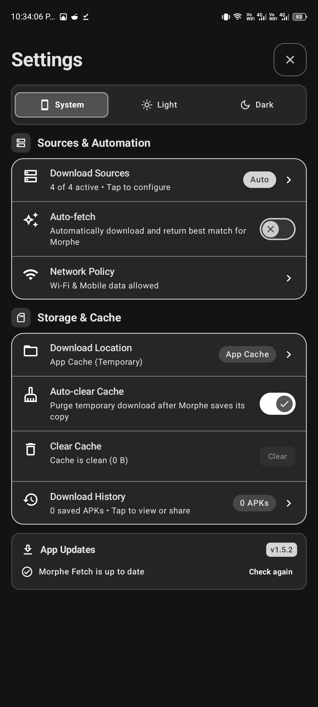
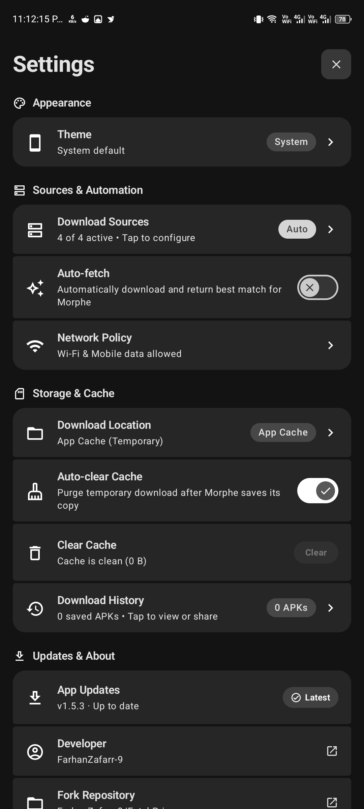

# FetchPrime 📦

[-3DDC84?style=flat-square&logo=android&logoColor=white)](https://developer.android.com)

I made FetchPrime as a personal UI rework of [morphe-fetch](https://github.com/Akash-Sriram/morphe-fetch), an Android download companion for [Morphe Manager](https://github.com/MorpheApp/morphe-manager) that can also find APKs on its own.

The project I forked is by [Akash Sriram](https://github.com/Akash-Sriram), and its original foundation is [helper-for-morphe](https://github.com/rushiranpise/helper-for-morphe) by [Rushi Ranpise](https://github.com/rushiranpise). I do not claim credit for their downloader, integrations, or the work contributed by the upstream authors and community. My contribution is the interface rework and the fork-specific changes described below.

## Why I made this

I enjoy working on interfaces, and I wanted to try a layout that fits my own taste: connected rows, softer shapes, fewer outlines, and actions grouped with the content they belong to.

This is not a critique of the original UI. Everyone has different preferences, and an interface I enjoy may not be the one someone else prefers. I appreciate the original work that made this possible; I am sharing my take for anyone who likes this style too.

## What I changed

I focused on the settings, browsing, and download screens:

- **Connected rows and cards:** I grouped related options with small gaps and rounded outer corners across settings, app lists, and bundle details.
- **Filled surfaces:** I replaced many outlines with tonal backgrounds in search fields, dialogs, cards, and controls.
- **Buttons and actions:** I used pill-shaped buttons and circular controls, keeping download, history, and source-site actions together inside their cards.
- **Version history and fallback states:** I brought version lists, manual fallback actions, and verification or error notices into the relevant source card. I also adjusted version discovery when a search has no direct match.
- **Settings and updates:** I reorganized the settings rows, added fork information, and made the update dialog display formatted release notes.
- **Navigation and larger screens:** I adjusted list presentation and the two-pane layout, with fewer visual separators and no visible list scrollbars.
- **Branding and coexistence:** I added the FetchPrime name and artwork, pointed the updater at my releases, and gave the app its own package so it can sit alongside the original.

## Updates and maintenance

I work on this out of personal interest and in my available time. Keeping the rework aligned with upstream changes takes testing and maintenance, so my releases may sometimes lag behind. If you need the latest upstream fixes promptly, please use [the original morphe-fetch project](https://github.com/Akash-Sriram/morphe-fetch).

---

## Before and after

I reworked the interface to suit my own preferences; these comparisons are not a critique of the original design. The original project and its contributors retain credit for the downloader and its foundations.

Each pair shows Morphe Fetch on the left and FetchPrime on the right. These are interface comparisons taken at different times; displayed sources, results, counts, and switch states may differ.

### Settings

Settings organization, theme selection, connected rows, and updates/about information.

| Morphe Fetch — original | FetchPrime — my rework |
| --- | --- |
|  |  |

Download sources

Download-source controls, expanded source options, and source selection actions.

| Morphe Fetch — original | FetchPrime — my rework |
| --- | --- |
|  |  |

Search results and download candidates

Candidate cards with download, version history, and source-site actions.

| Morphe Fetch — original | FetchPrime — my rework |
| --- | --- |
|  |  |

Download complete

The completion screen with actions for Morphe, installation, sharing, and finishing.

| Morphe Fetch — original | FetchPrime — my rework |
| --- | --- |
|  |  |

Search and download history

The home search field and saved-download cards.

| Morphe Fetch — original | FetchPrime — my rework |
| --- | --- |
|  |  |

Find New Apps

App browsing with search, filtering, sorting, and connected app rows.

| Morphe Fetch — original | FetchPrime — my rework |
| --- | --- |
|  |  |

Patch bundles

Bundle browsing with patch counts, compatible app counts, and repository actions.

| Morphe Fetch — original | FetchPrime — my rework |
| --- | --- |
|  |  |

Expanded bundle details

Compatible apps grouped inside an expanded bundle card.

| Morphe Fetch — original | FetchPrime — my rework |
| --- | --- |
|  |  |

App and patch details

The app details screen and connected patch-description rows.

| Morphe Fetch — original | FetchPrime — my rework |
| --- | --- |
|  |  |

[View all original screenshot files](docs/Screenshots).

---

## Install alongside the original

Starting with FetchPrime **1.5.3**, my application ID is **`app.morphe.fetchprime`**. The original uses `app.morphe.fetch`, so both can be installed together. Download the signed APK from [my releases](https://github.com/FarhanZafarr-9/FetchPrime/releases/latest).

This is a separate installation with its own settings, history, and permissions. FetchPrime 1.5.2 used the original package name; install 1.5.3 separately instead of using that older build's in-app updater, which correctly rejects APKs with a different package name. You can keep the old installation until you have set up the new one.

The permanent FetchPrime signing key is unchanged. Future updates to `app.morphe.fetchprime` will use the same key.

---

## Features I carry over from upstream

The downloader and its integrations come from the projects this fork builds on. I have kept those capabilities available behind my reworked interface:

- **Multi-Source Parallel Resolution** — Concurrently queries all enabled sources (Google Play via Aurora, APKMirror, APKPure, and Uptodown) to fetch recommended architectures and compatible versions without manual hunting.
- **Find New Apps (Archive Explorer)** — Built-in catalog of 100+ patchable applications and community repositories. Includes live GitHub catalog sync, offline fallback, favourites bookmarking, and smart installed/patched app status detection.
- **Download Stream & Archive Integrity** — Validates download streams against server content lengths, verifies ZIP/DEX file integrity before handoff, and extracts signing certificates to protect against corrupt or tampered binaries.
- **Headless Cloudflare Solver** — Background Turnstile solver, ad-blocking engine, and session keeper for seamless downloads on protected mirrors.
- **Aurora Store & MicroG-RE Integration** — One-tap anonymous Google Play token acquisition via installed MicroG-RE or verified fallback dispensers for direct Play Store CDN delivery.
- **Universal Format Support** — Fully parses, verifies, and packages standalone `APK` files as well as split bundles (`APKM`, `APKS`, and `XAPK`).
- **Morphe Manager Integration** — Automated handoff via Android intents (`ACTION_DOWNLOAD_ORIGINAL_APK`), routing clean stock binaries directly to Morphe Manager's patching pipeline.
- **Modern Jetpack Compose Architecture** — Material 3 dynamic color, edge-to-edge system bars, pull-to-refresh, adaptive tablet two-pane layout, and responsive navigation.

---

## Supported Sources

| Source | Description | Features |
|---|---|---|
| **Aurora Store** | Direct Google Play CDN | Anonymous check-in via MicroG-RE, architecture filtering, split-APK delivery |
| **APKMirror** | Verified community mirror | Architecture variants, release dates, automated session warmer |
| **APKPure** | Versioned archive API | Fast direct CDN downloads with device-matched ABIs |
| **Uptodown** | Global software directory | Background Turnstile bypass and direct variant downloads |

---

## Credits and upstream

I maintain this UI fork as [FarhanZafarr-9](https://github.com/FarhanZafarr-9). Credit for the original downloader and its foundations belongs to the upstream authors and contributors:

- [Akash Sriram's morphe-fetch](https://github.com/Akash-Sriram/morphe-fetch), the project I forked.
- [Rushi Ranpise's helper-for-morphe](https://github.com/rushiranpise/helper-for-morphe), the original project it builds on.
- The contributors and libraries credited by those projects.

I chose a separate name to identify my version. It does not imply that the original authors endorse my changes. I retain the upstream license and attribution.

---

## License

Licensed under the [GNU General Public License v3.0](LICENSE).
